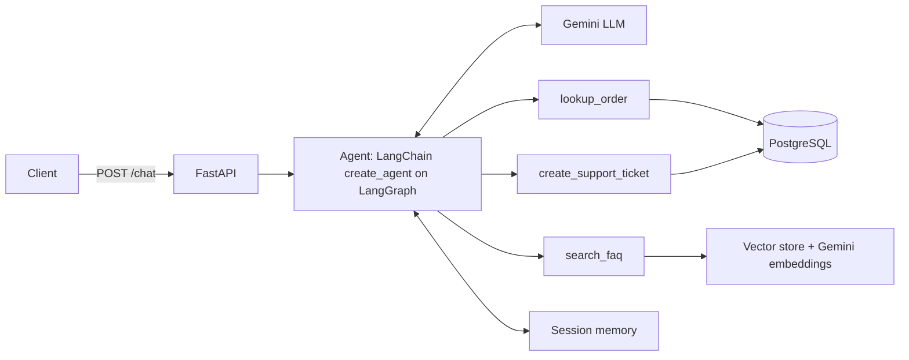

# Support Desk Agent

An agentic AI customer-support assistant built with **FastAPI**, **LangChain / LangGraph**, **Gemini** and **PostgreSQL**.

A customer sends a message. An LLM agent decides what to do: look up an order, answer a policy question from an FAQ (RAG), or open a support ticket. It keeps conversation memory per session.

> Practice project using fake data only.

## What it does

| Capability | How |
|---|---|
| Order lookup | `lookup_order` tool queries the `orders` table in PostgreSQL |
| Support tickets | `create_support_ticket` tool inserts into the `tickets` table, only after the customer agrees |
| FAQ answers (RAG) | `search_faq` tool retrieves relevant sections of `faq.md` using Gemini embeddings and a vector store |
| Conversation memory | LangGraph checkpointer keyed by `session_id` |
| Structured output | `/triage` endpoint classifies a message into category, urgency and summary (Pydantic schema) |
| Guardrails | Answers only from tool results and says "I don't know" when the FAQ has no answer |

## Architecture



## Tech stack

Python, FastAPI, Pydantic, LangChain, LangGraph, Google Gemini (LLM + embeddings), PostgreSQL (psycopg), Pytest.

## Project structure

```
main.py        FastAPI app: /health, /triage, /chat
agent.py       Agent, tools, system prompt, memory
db.py          PostgreSQL helpers (get_order, create_ticket)
rag.py         FAQ loading, embeddings, similarity search
faq.md         Sample company policies
schema.sql     orders table + fake data
tickets.sql    tickets table
tests/         Pytest tests (no LLM or database needed)
```

## Setup

1. Clone the repo and create a virtual environment:
   ```
   python -m venv venv
   venv\Scripts\activate        # Windows
   pip install -r requirements.txt
   ```
2. Create a database and load the sample data:
   ```
   psql -U postgres -c "CREATE DATABASE supportdesk;"
   psql -U postgres -d supportdesk -f schema.sql
   psql -U postgres -d supportdesk -f tickets.sql
   ```
3. Get a free Gemini API key from Google AI Studio, then copy `.env.example` to `.env` and fill in your values.
4. Run the app:
   ```
   uvicorn main:app --reload
   ```
5. Open `http://127.0.0.1:8000/docs` to try the endpoints.

## Example conversation

Request to `POST /chat`:

```json
{ "text": "Where is my order ORD-1002?", "session_id": "asha" }
```

The agent calls `lookup_order`, reports the delay, apologises and offers a ticket. Then:

```json
{ "text": "Yes please", "session_id": "asha" }
```

The agent remembers the order from the earlier message and calls `create_support_ticket`.

## Tests

```
pytest
```

The tests mock the database and the LLM, so they run without credentials.

## Limitations and next steps

- Session memory and the FAQ vector store are in memory, so they reset when the server restarts. Next: a PostgreSQL checkpointer and a persistent vector database such as Chroma.
- The agent is built with LangChain's `create_agent` (which runs on LangGraph). Next: an explicit LangGraph `StateGraph` for custom routing.
- Free-tier Gemini limits can cause slow responses or timeouts.
- Planned: authentication, a simple UI, and evaluation of answer quality.
